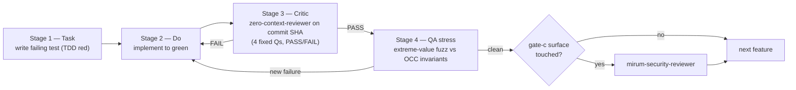
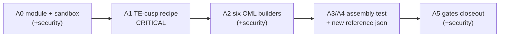
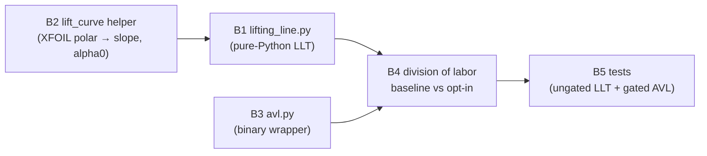

# Deterministic Aero Geometry (`cad_aero`) + 3-D Aero — Implementation & Testing Methodology

> **Status:** plan (no pipeline code yet). This document is the self-contained
> execution artifact for the deterministic-aero milestone. A reader should be
> able to implement every feature below without the originating brainstorm.
>
> **Branch convention:** standalone-first, two tracks (see *Scope & decisions*).
> **Gates reference:** `.claude/rules/worktree-merge-gate.md`.
> **Agents reference:** `.claude/agents/zero-context-reviewer.md`,
> `.claude/agents/qa-stress-tester.md`, `mirum-security-reviewer`
> (`.claude/skills/mirum-security-review/SKILL.md`).

---

## 1. Why this milestone exists

Domain-D (aerospace) generation is currently non-deterministic: the same prompt
can yield different geometry because the load-bearing shapes are produced by
free-form LLM-authored CadQuery. The fix is to move that geometry into a
curated, sandbox-allowlisted builder module — `backend/cad_aero.py` — whose
functions are pure and deterministic by construction, and to upgrade the
2-D-only aero analysis (cross-sectional XFOIL) to true 3-D (Prandtl
lifting-line + AVL).

The intended outcome:

- The Machinist composes wings/control-surfaces from `cad_aero` builders instead
  of emitting free-form B-rep code, so the **same prompt → same topology + part
  count + mass within ε** (not byte-equal STEP — see Hole #4).
- Aero performance is evaluated in 3-D, with an always-available analytic
  baseline (lifting-line) and an opt-in higher-fidelity path (AVL) that
  graceful-degrades exactly like the existing XFOIL wrapper.

---

## 2. Scope & decisions

Two decisions from the brainstorm are already resolved and baked into this plan:

| # | Decision | Consequence |
|---|----------|-------------|
| Hole #1 | **Full OML, retire the box-beam reference.** | The TE-cusp recipe (A1) becomes the *critical path* — no OML builder works until it is solved. The 67.6 kg box-beam mass is retired; A3/A4 mints a new reference artifact. |
| Hole #6 | **Two tracks, standalone-first.** | Track A (`backend/cad_aero.py`) and Track B (`analysis/`) ship as standalone, tested modules. **All pipeline wiring is deferred** to follow-on branches (mirrors how the XFOIL analysis shipped standalone before its wiring branch). |

**Explicitly out of scope (deferred follow-on branches):** Planner 12-part
decomposition lock, REA spec extraction, `backend/schemas.py` fields,
AeroSubagent 3-D stage, frontend performance cards, eval-harness regression
slice for the new builders. Do not implement these here.

---

## 3. The methodology every feature inherits

This milestone uses the existing **Task → Do → Verify** loop and the three
**worktree merge gates**. Every feature unit below (A0–A5, B1–B5) is executed
through the same five-step block.



### Per-feature verification block (repeat for every unit)

1. **Task (TDD red).** Write the failing test first.
   - Geometry units → mirror `backend/tests/test_geometry_verification.py`
     (OCC-gated: `try: import OCC … except ModuleNotFoundError: skip`, so the
     suite stays green where OCC lives only in Docker).
   - Pure-Python units → mirror `analysis/tests/test_airfoil.py` (ungated).
   - Confirm the test goes **red** without the production change — this is what
     the zero-context reviewer's "passes for the wrong reason" check depends on.
2. **Do.** Implement the minimum to turn the test green. Commit.
3. **Critic (Stage 3).** Dispatch `zero-context-reviewer` on the commit SHA:
   ```
   Agent({ subagent_type: "zero-context-reviewer",
           description: "Stage-3 review <unit>",
           prompt: "Review commit <SHA> in <worktree path>. Claim: '<unit one-liner>'." })
   ```
   Must return **PASS**. A FAIL loops back to step 2 with the named concern.
4. **QA stress (Stage 4).** **Read this distinction carefully:**
   - For the **standalone builders & pure-Python aero**, "stress" means
     **parametric extreme-value fuzzing** of the function itself — the
     brainstorm's scale/feature axes expressed as unit-test parameters
     (tiny/huge chords, extreme twist & dihedral, high `n_lightening_holes`,
     degenerate t/c, 3- vs 256-station counts) asserted against the OCC validity
     invariants (valid + vol>0 + BRepCheck clean + bbox within envelope).
   - The Gemini-prompt-mutation `qa-stress-tester` agent is **NOT** used here —
     it mutates *prompts* through the live pipeline and costs Gemini quota. It
     only applies once pipeline wiring lands (deferred). Do not burn quota
     stress-testing pure functions.
5. **Security (gate c).** REQUIRED for any unit whose diff touches
   `_ALLOWED_MODULES` / `backend/compiler.py` — that is **A0, A2, A5**. Dispatch
   `mirum-security-reviewer`; its CRITICAL/HIGH sections must be empty. Track B
   touches no sandbox surface → no security gate (its gate is binary
   availability, not security).

### Merge gates (from `worktree-merge-gate.md`)

- **(a) Schema tests — always:** `python backend/tests/test_prompts_schema.py`,
  `test_runner_filters.py`, `test_md_report.py` (pure-stdlib, <1s).
- **(b) Regression slice — always:** `python -m eval_harness.runner
  --regression-for D --report-md output/qa-reports/<date>-D.md`, diffed vs the
  latest `main` baseline; **no newly-failing ids**.
- **(c) Security review — conditional:** as in step 5 above.

---

## 4. Track A — `backend/cad_aero.py`: deterministic OML builders

Critical path (strict order): **A0 → A1 → A2 → A3/A4 → A5.** A1 precedes the
builders because every OML builder depends on a valid trailing-edge recipe.



### A0 — Module + sandbox setup  *(security gate required)*

**Build steps**

1. Create `backend/cad_aero.py`. Imports limited to `import cadquery as cq`,
   `import math`, and internal `import cad_utils`. Transitive imports inside
   `cad_aero` are fine — the AST scanner (`backend/compiler.py:77-105`) only
   inspects the *script's* imports, not the allowlisted module's.
2. Add `"cad_aero"` to `_ALLOWED_MODULES` at `backend/compiler.py:51`
   (`{"cadquery", "cq", "math", "cad_utils"}` → add `"cad_aero"`). **This is the
   security-sensitive change** — any LLM script can now import `cad_aero`.
3. Module docstring freezes ONE coordinate frame (**fixes Hole #2**):
   `Y = span, X = chord, Z = thickness, origin = root LE, dihedral = z-offset,
   twist about quarter-chord (x/c = 0.25), linear root→tip`. Every builder obeys
   it; no builder takes its own independent frame convention.
4. Migrate `validate_solid` and `_dedupe_pts` from the local golden script as
   private helpers (`_validate_solid`, `_dedupe_pts`). `_validate_solid` returns
   pass/fail on: is-solid + vol>0 + BRepCheck clean + bbox within a supplied
   envelope — mirror the checks in `backend/verification/geometry.py`
   (`_check_is_solid`, `_measure_volume`, `_check_brep_valid`,
   `_measure_bounding_box`).

**Verification block:** TDD red (import-and-frame smoke test, OCC-gated) → green
→ `zero-context-reviewer` PASS → parametric fuzz of `_validate_solid` against a
known-good box and known-bad zero-volume shell → **`mirum-security-reviewer`**
on the `_ALLOWED_MODULES` diff.

### A1 — TE-cusp recipe  *(CRITICAL path)*

The known failure: `cq.Workplane.polyline(airfoil_points).close().extrude(t)`
produces an invalid B-rep on NACA 4-digit profiles near the trailing-edge cusp.

**Build steps**

1. Implement three candidate `te_method` strategies behind one parameter:
   - `(1) trim` — trim to `x/c ≤ 0.995`, close with a straight segment.
   - `(2) loft` — loft between two offset wires at `z = ±t/2`, `ruled=True`.
   - `(3) spline` — B-spline-fit the contour via `.spline(...)` then extrude.
2. Test matrix: **3 NACA (0012, 2412, 4415) × 3 t/c × 3 candidates = 27 cells.**
3. **Likely winner = candidate (3)**: `cad_utils.make_naca_wire`
   (`cad_utils.py:172`) already emits a valid B-spline airfoil wire in
   production — the cusp failure is in extruding a *closed polyline*, not in the
   curve. Reusing that working wire de-risks the full-OML bet.
4. Winner becomes the **default** `te_method`; the two losers stay as
   escape-hatch parameter values (don't delete them — they're fallbacks for
   profiles the default trips on).

**Acceptance:** BRepCheck clean **and** vol>0 across all 9 cells (3 NACA × 3 t/c)
for the chosen winner.

**Verification block:** the 27-cell matrix *is* the TDD test (OCC-gated) → green
→ `zero-context-reviewer` PASS (confirm the test fails for the right reason: a
deliberately-broken polyline extrude must go red) → parametric fuzz at thin t/c
(e.g. 0008) and near-zero chord. No security gate (no compiler change in A1).

### A2 — The six OML builders  *(security gate required)*

All builders are **keyword-only, pure, true-OML**, and end in `_validate_solid`.

| Builder | Notes / hole fixes |
|---------|--------------------|
| `make_spar` | Twist about quarter-chord per the frozen frame. |
| `make_rib` | OML outline **always**. `n_lightening_holes` is **auto-spaced + clamped** with a validity guard so holes can't intersect the spar caps (**fixes Hole #5**). |
| `make_stringer` | Section profile (e.g. L/Z/hat), runs spanwise. |
| `make_wing_skin_panel` | Curved airfoil-wrapped skin (upper/lower), root→tip thickness taper. |
| `make_root_fitting` | Bolt pattern; interfaces with spar at root. |
| `make_control_surface` | Returns **the flap solid only**, rotated about the hinge line. Parent-cove trim is **out of scope v1** (**Hole #3**); it is an additive part family, not part of golden reproduction. |

Each builder ends with `_validate_solid`: valid + vol>0 + BRepCheck clean + bbox
within envelope (the determinism target is invariants, not byte-equality — see
Hole #4 in A5).

**Verification block (per builder, six times):** TDD red OCC-gated test → green →
`zero-context-reviewer` PASS → **parametric extreme-value fuzz** (scale: 1 mm to
10 m chord; feature: `n_lightening_holes` from 0 to absurd; twist ±30°, dihedral
±15°; edge counts where relevant) asserting the validity invariants hold or the
builder clamps/raises cleanly → **`mirum-security-reviewer`** once on the
combined `cad_aero.py` builder diff.

### A3/A4 — Cross-builder assembly test + new reference artifact

**Build steps**

1. **Assembly test (fixes Hole #2 properly):** assert **interface contact**, not
   just per-part validity + mass. Specifically: rib stations are coincident with
   spar y-faces, and skin meets the spar caps — assert via bbox-overlap at the
   interfaces so **no part floats disconnected**. (The old cross-check passed
   even with floating parts; that is the hole.)
2. **New reference (fixes Hole #1 + Hole #9):** lock canonical NACA-2412-class
   params, build the OML assembly once, capture **part count + mass + bbox** →
   `output/wing_assembly_oml_reference.json`. This is the new regression anchor.
   It **replaces** the retired 67.6 kg box-beam number (which was a circular
   Raymer estimate — Hole #9). Phase-5-style margin checks must assert against
   real loads from the `analysis/` structural code, never back-calculated golden
   numbers.

**Verification block:** TDD red (assembly contact assertions) → green →
`zero-context-reviewer` PASS (watch for the "coincidental bbox overlap" failure
mode — require a fixture where a disconnected variant goes red) → fuzz the
canonical params ±20% and confirm the contact invariants survive. No new
compiler surface → no extra security gate (covered by A2/A5).

### A5 — Gates closeout  *(security gate required)*

1. All A-track tests are OCC-gated and mirror
   `backend/tests/test_geometry_verification.py` structure.
2. **Determinism caveat (documents Hole #4):** the target is *"same topology +
   part count + mass within ε"*, **NOT** byte-equal STEP — OCC loft/B-spline
   output is not guaranteed bit-identical across versions/platforms. Tests
   assert **invariants, not file hashes**. True end-to-end repeatability also
   needs a locked Planner decomposition + `temp=0` + a canonical recipe — that
   lives in the **deferred** pipeline-wiring branch, not here.
3. Final **`mirum-security-reviewer`** pass over the cumulative
   `_ALLOWED_MODULES` + `cad_aero.py` diff (gate c). CRITICAL/HIGH empty.

---

## 5. Track B — 3-D aero (standalone, `analysis/`, no security gate)

Runs in parallel with Track A (disjoint files). **Mirror the real existing
standalone pattern `analysis/airfoil.py`** — TypedDict in/out, module-level
custom exceptions, `_resolve_*_bin` env-var resolution, `subprocess.run`, a
`mock_*` test double. (Note: `analysis/structures.py` referenced in the
brainstorm does **not** exist in this repo; `airfoil.py` is the pattern to copy.)



### B1 — `analysis/lifting_line.py`

Pure-Python Prandtl lifting-line theory; imports `math` + `typing` only.
Composable helpers + one orchestrator:

```python
def prandtl_lifting_line(
    chord_distribution_m: list[float],
    twist_distribution_deg: list[float],
    sectional_cl_alpha_per_rad: float,
    sectional_cl_alpha0_deg: float,
    span_m: float,
    aoa_root_deg: float,
    velocity_ms: float,
    density_kgm3: float,
    n_fourier_terms: int = 40,
) -> WingPolarPoint: ...
```

`WingPolarPoint` (TypedDict): `CL_3D`, `CDi`, `span_efficiency_e`,
`L_distribution`, `Cl_local`, plus `passed: bool` and `warnings: list[str]`
(match the `passed`/`warnings` convention used by the analysis layer).
**Documented v1 limitation (Hole #7):** constant sectional slope across span
(real wings vary Re per station).

### B2 — `lift_curve_slope_and_alpha0(polar)`

Linear-fits the existing `analysis/airfoil.py` `PolarResult` (which exposes
α/Cl lists, **not** a fitted slope) → `(cl_alpha_per_rad, alpha0_deg)`. Without
this helper the LLT inputs in B1 don't exist (**Hole #7**). This is why B2 is a
dependency of B1's real-data path.

### B3 — `analysis/avl.py`

AVL binary wrapper mirroring `airfoil.py`:

- Exceptions `AvlNotFoundError` / `AvlRunError` (mirror `XfoilNotFoundError` /
  `XfoilRunError` at `analysis/airfoil.py:98-106`).
- `_resolve_avl_bin`: override arg → `MIRUM_AVL_BIN` env → `bin/avl.exe` →
  PATH (mirror `_resolve_xfoil_bin`).
- `_build_avl_geometry`: generate the `.avl` geometry file (sections / chord /
  twist / dihedral / control surfaces) **plus** a run-case file — this is the
  real work, unlike XFOIL's "NACA 0012" one-liner.
- `subprocess.run` + parse forces.
- **Hole #8:** AVL is **inviscid** → returns CL / CDi / e / stability
  derivatives / control effectiveness, but **no Cd_total and no stall**.

### B4 — Division of labor (Hole #8)

- `lifting_line.py` = **always-available analytic baseline**.
- `avl.py` = **opt-in higher-fidelity**, graceful-degrades when the binary is
  absent (raises `AvlNotFoundError`, caller skips — same contract as XFOIL).
- They share `CL / CDi / e`; AVL is preferred when present.

### B5 — Tests

- **LLT (B1/B2): pure-Python, ungated.** Validate against analytic truths:
  elliptic loading → `span_efficiency_e ≈ 1`; `CL_3D < CL_2D` for finite span.
- **AVL (B3): gated on binary** via a `mock_avl` double (mirror
  `analysis/tests/mock_xfoil`), plus an `AvlNotFoundError`-on-bogus-path test.

**Verification block (each B unit):** TDD red → green → `zero-context-reviewer`
PASS → parametric fuzz (B1: degenerate span, single station, `n_fourier_terms`
extremes; B3: malformed `.avl`, missing binary). **No security gate** — Track B
touches no sandbox surface.

---

## 6. Sequencing summary

- **Track A** (critical chain): `A0 → A1 → A2 → A3/A4 → A5`.
- **Track B**: `B2 → B1` (B1 needs B2's slope), `B3` in parallel, then `B4 → B5`.
- **A ∥ B** (disjoint files — can proceed concurrently).
- **Deferred** (do not build here): all pipeline wiring listed in §2.

---

## 7. Final integration review (after BOTH tracks land)

A whole-milestone closeout, distinct from the per-feature loops:

1. **Full zero-context review.** Dispatch `zero-context-reviewer` over the
   integration commit range (not a single feature commit), four fixed questions,
   **PASS required**. Because it is zero-context, it cannot rationalize from this
   plan — it re-derives correctness from the diff alone.
2. **Full QA pass.**
   - Gate (a) schema tests: `test_prompts_schema.py`, `test_runner_filters.py`,
     `test_md_report.py` — all green.
   - Gate (b) Domain-D regression slice: `python -m eval_harness.runner
     --regression-for D --report-md output/qa-reports/<date>-D.md`, diffed vs the
     latest `main` baseline — **no newly-failing ids**.
   - Once pipeline wiring exists (deferred branch), dispatch `qa-stress-tester`
     on base prompt `D_multipart_wing_assembly`, capturing any new failures back
     into `backend/eval_harness/prompts.json` with `regression_for` tags.
3. **Security closeout.** Final `mirum-security-reviewer` over the
   `_ALLOWED_MODULES` + `cad_aero.py` surface; CRITICAL/HIGH must be empty (or
   carry an explicit inline justification per gate c).

Only when 1–3 all pass does the milestone merge to `main`.

---

## 8. Hole → fix traceability

| Hole | Where addressed |
|------|-----------------|
| #1 OML vs box-beam (DECISION) | §2; A3/A4 mints new OML reference, retires 67.6 kg |
| #2 Shared frame + interface contact | A0 frozen frame; A3/A4 contact assertions |
| #3 `make_control_surface` boundary | A2 — flap solid only, parent trim out of scope v1 |
| #4 Determinism ≠ pipeline determinism | A5 — invariants not file hashes; pipeline lock deferred |
| #5 Lightening-hole validity | A2 `make_rib` — auto-space + clamp + validity guard |
| #6 3-D aero scope (DECISION) | §2 — two tracks, standalone-first; Track B disjoint |
| #7 LLT inputs don't exist / constant slope | B2 helper; B1 documented limitation |
| #8 AVL ≠ XFOIL-shaped | B3 inviscid outputs; B4 division of labor |
| #9 Circular structural margins | A3/A4 — assert real `analysis/` loads, retire Raymer estimate |
